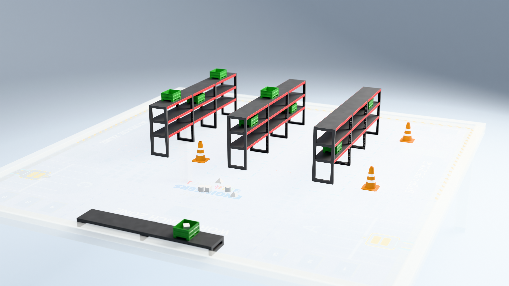

# HP Robots 3D printed kit for WRO Future Engineers – Smart Warehouse

3D-printable game elements for **WRO 2027 Future Engineers – Smart Warehouse**, published by HP Robots and made by MORAVIA Consulting, Brno.

Prefer a ready-made set? The printed kit is available in the [shop](https://shop.moravia.education/wro-future-engineers-smart-warehouse.html).

## Download

Get the [latest release](../../releases/latest): one ZIP with all STL files and the assembly manual.

## What's in the set

| Item | Quantity | Folder |
| --- | --- | --- |
| Rack | 3 | [`stl/rack`](stl/rack) |
| Workbench | 1 | [`stl/workbench`](stl/workbench) |
| Box | 9 | [`stl/boxes`](stl/boxes) |
| Maintenance cone | 4 | [`stl/objects`](stl/objects) |
| Objects | 6 | [`stl/objects`](stl/objects) |

You also need wooden dowels, Ø 8 mm, in 35 mm and 50 mm lengths. We recommend buying long Ø 8 mm sticks and cutting them to length. If you decide to 3D print the dowels, models can be found in [`stl/dowels`](stl/dowels).

## Print settings

| Setting | Value |
| --- | --- |
| Material | PLA (HP Filament FastPLA) |
| Layer height | 0.2 mm |
| Infill | 15% (pattern dependent on part and printer) |
| Walls | min. 2 |
| Supports | no supports |

## Assembly

The parts join with wooden dowels. The assembly manual is in [`manual/`](manual).

## Found a problem?

[Open a new issue](../../issues/new/choose) and tell us the version, the part and what happened.

## License

See [LICENSE](LICENSE).
